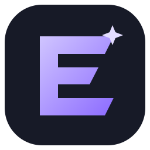

<p align="center">
  
</p>

<h1 align="center">Elysium Launcher</h1>

<p align="center">
  Minecraft-лаунчер на C++ / Qt 6.<br>
  Интерфейс Midnight, библиотека сборок и компактный режим запуска.
</p>

<p align="center">
  <a href="https://github.com/artemii14/ubiquitous-happiness/actions/workflows/windows.yml"></a>
  <a href="https://github.com/artemii14/ubiquitous-happiness/actions/workflows/elysium.yml"></a>
</p>

<p align="center">
  <a href="#скачать">Скачать</a> ·
  <a href="#возможности">Возможности</a> ·
  <a href="https://github.com/artemii14/ubiquitous-happiness/issues">Сообщить об ошибке</a> ·
  <a href="#сборка-из-исходников">Собрать самостоятельно</a>
</p>

> [!NOTE]
> Независимый форк [ElyPrismLauncher](https://github.com/ElyPrismLauncher/Launcher),
> основанного на [Prism Launcher](https://github.com/PrismLauncher/PrismLauncher).
> Не является официальным продуктом Prism Launcher, Ely.by или Mojang/Microsoft.
> Minecraft не входит в комплект. Для игры через Microsoft-аккаунт требуется право на игру.

## Скачать

**[Скачать Elysium Launcher 1.0](https://github.com/artemii14/ubiquitous-happiness/releases/tag/v1.0)** — релиз 1.0. Бинарники не подписаны.

- **[Windows — установщик EXE](https://github.com/artemii14/ubiquitous-happiness/releases/download/v1.0/ElysiumLauncher-Windows.exe)**
- **[Windows x64 — portable ZIP](https://github.com/artemii14/ubiquitous-happiness/releases/download/v1.0/ElysiumLauncher-Windows-x64-portable.zip)**
- **[Linux x64 — AppImage](https://github.com/artemii14/ubiquitous-happiness/releases/download/v1.0/ElysiumLauncher-Linux-x86_64.AppImage)**
- [SHA-256 файлов релиза](https://github.com/artemii14/ubiquitous-happiness/releases/download/v1.0/SHA256SUMS.txt)

Распакуйте Windows ZIP целиком и запустите `elysiumlauncher.exe`; это переносная версия, не установщик.
Для установки используйте `ElysiumLauncher-Windows.exe`; для запуска без установки — portable ZIP.
Релиз не обновляет уже скачанные файлы автоматически. Самые новые экспериментальные сборки также доступны в Actions ниже.
Изменения Elysium разрабатываются в ветке [`arena/66b41468-ubiquitous-happiness`](https://github.com/artemii14/ubiquitous-happiness/tree/arena/66b41468-ubiquitous-happiness), отдельно от `main`.

| Платформа | Сборка | Артефакт |
|---|---|---|
| Windows x64 | [Windows build](https://github.com/artemii14/ubiquitous-happiness/actions/workflows/windows.yml) | `ElysiumLauncher-Windows-x64-portable` — ZIP |
| Linux x64 | [Linux build](https://github.com/artemii14/ubiquitous-happiness/actions/workflows/elysium.yml) | `ElysiumLauncher-Linux-x86_64-AppImage` |

1. Откройте нужный workflow и выберите **успешный запуск нужной ветки и коммита**.
2. Внизу страницы, в **Artifacts**, скачайте архив. Для скачивания GitHub может потребовать вход.
3. Windows: распакуйте ZIP целиком и запустите `elysiumlauncher.exe`.
4. Linux: извлеките AppImage, разрешите исполнение и запустите:

   ```sh
   chmod +x ElysiumLauncher-Linux-x86_64.AppImage
   ./ElysiumLauncher-Linux-x86_64.AppImage
   ```

Linux-сборка рассчитана на Ubuntu 24.04 / glibc 2.39 или новее.
Артефакты **Actions** хранятся 14 дней; файлы **Release** публикуются отдельно.
[Подробнее о Windows-сборках](docs/WINDOWS-GITHUB.md).

> [!WARNING]
> Перед тестированием сделайте резервную копию миров и сборок.
> Бинарники не подписаны; успешный CI не является антивирусной проверкой.
> Не отключайте защиту системы ради запуска. При блокировке сохраните точный текст предупреждения
> и сообщите о нём в Issues без публикации персональных данных.

## Продолжение работы в новом чате

**[CHAT_HANDOFF.md](CHAT_HANDOFF.md)** в корне репозитория содержит историю изменений,
важные решения, расположение кода, результаты проверок и оставшиеся задачи.
В новом чате напишите: **«Прочитай CHAT_HANDOFF.md в корне репозитория и продолжи работу»**.

## Возможности

### Интерфейс Midnight

- Тёмная тема с лавандовыми акцентами и собственным SVG-набором значков.
- **Modern** — библиотека с поиском, сортировкой и правой панелью действий.
- **Legacy** — компактный выбор сборки и запуск.
- Выбор режима в настройках лаунчера; тему и набор значков можно менять независимо.
- Поиск по имени и группе: `Ctrl+K`, очистка поля — `Esc`.
- Смена иконки выбранной сборки нажатием на неё в правой панели.

### Быстрая установка

- **Vanilla** — выбор версии с автоматическим именем новой сборки.
- **Sodium-сборки** для Fabric и NeoForge: актуальный каталог Modrinth,
  Sodium, Iris, LambDynamicLights, Zoomify либо Ok Zoomer.
- Fabric API обязателен для Fabric; Sodium Extra и Mod Menu добавляются по возможности.
- Проверка зависимостей по метаданным Modrinth и SHA-512 скачанных модов.
- Каждая установка Sodium создаёт отдельный экземпляр — существующие сборки не обновляются автоматически.
- Локальный импорт подходящего LaunchWrapper-профиля OptiFine, **без раздачи или автоматического скачивания OptiFine**.

[Режимы и OptiFine](docs/INTERFACE-MODES.md) · [Условия и ограничения Sodium-сборок](docs/SODIUM-PRESETS.md)

### Сеть ZeroTier

Встроенная панель управления **отдельно установленным ZeroTier One**: подключение по Network ID,
статус сетей, копирование IP и отключение. Может требоваться настройка доступа к локальной службе.
Установка необязательна и предлагается через официальный сайт.
**Функции публикации/поиска хостов нет.** Для игры сообщите друзьям `ZT IP:порт` вручную.
[Инструкция и безопасность](docs/ZEROTIER.md).

### Продолжение работы в новом чате

**[CHAT_HANDOFF.md](CHAT_HANDOFF.md)** в корне репозитория содержит историю изменений,
важные решения, расположение кода, результаты проверок и оставшиеся задачи.
В новом чате напишите: **«Прочитай CHAT_HANDOFF.md в корне репозитория и продолжи работу»**.

## Возможности основы ElyPrism / Prism

Аккаунты Ely.by и Microsoft, отдельные экземпляры Minecraft, загрузчики модов,
интеграции Modrinth/CurseForge, управление Java, модами, мирами, ресурс-паками,
шейдерами, логами, импорт и экспорт сборок.
Доступность сервисов зависит от их API, регистраций приложения и условий использования.

## Поддержка и предложения

Нашли проблему или хотите предложить улучшение? [Создайте Issue](https://github.com/artemii14/ubiquitous-happiness/issues/new/choose).
Можно писать **по-русски или по-английски**. Укажите ОС, коммит/сборку, шаги воспроизведения
и ожидаемый результат. Перед отправкой логов удалите токены, пароли, адреса электронной почты
и другие личные данные. Ошибки этого форка не следует отправлять разработчикам Prism/ElyPrism.

[Участие в разработке](CONTRIBUTING.md) · [Правила сообщества](CODE_OF_CONDUCT.md)

## Сборка из исходников

Нужны CMake ≥ 3.25, C++20, Ninja, Qt ≥ 6.8 (Core, Widgets, Concurrent, Network,
Test, Xml, NetworkAuth, OpenGL), Extra CMake Modules, cmark, libarchive,
libqrencode, zlib, toml++ ≥ 3.2. На Linux также нужен development-пакет gamemode.
Для `CMakePresets.json` требуется CMake с поддержкой presets schema 8.
Точные наборы зависимостей CI: [Windows](.github/workflows/windows.yml) и [Linux](.github/workflows/elysium.yml).

```sh
git clone --recurse-submodules --branch arena/66b41468-ubiquitous-happiness https://github.com/artemii14/ubiquitous-happiness.git
cd ubiquitous-happiness
cmake -S . -B build -G Ninja \
  -DCMAKE_BUILD_TYPE=Release -DBUILD_TESTING=ON \
  -DCMAKE_INSTALL_PREFIX="$PWD/install"
cmake --build build --parallel 2
ctest --test-dir build --output-on-failure
cmake --install build
```

При отдельной установке Qt передайте `-DCMAKE_PREFIX_PATH=/path/to/Qt/6.x/gcc_64`
(либо путь к Qt для вашей платформы). На Linux установленный файл — `install/bin/elysiumlauncher`.
Структурные проверки: `python3 scripts/check_elysium.py`.
Нативные тесты и сборка не заменяют ручную проверку авторизации и запуска Minecraft.

## Происхождение и лицензии

Спасибо разработчикам **ElyPrismLauncher, Prism Launcher и MultiMC**, а также авторам
используемых библиотек и модов. Интерфейсы XMCL и Legacy использовались как ориентир
сценариев; это собственная Qt-реализация, а не объединение их приложений.

Код лаунчера: **GPL-3.0-only** — [LICENSE](LICENSE).
Лицензии и уведомления отдельных компонентов и ресурсов: [COPYING.md](COPYING.md),
[program_info/LICENSE](program_info/LICENSE) и файлы библиотек.
Авторские уведомления исходных проектов сохранены. Моды скачиваются из источника при установке
и не включены в репозиторий; у них собственные лицензии.

Исходная ревизия ElyPrism: `1c8bdd4dd72da77024a5dbb8bd8ef863540e3364`.
[Оригинальное описание проекта](docs/UPSTREAM-README.md) · [Чек-лист публичного релиза](docs/RELEASE-CHECKLIST.md)
